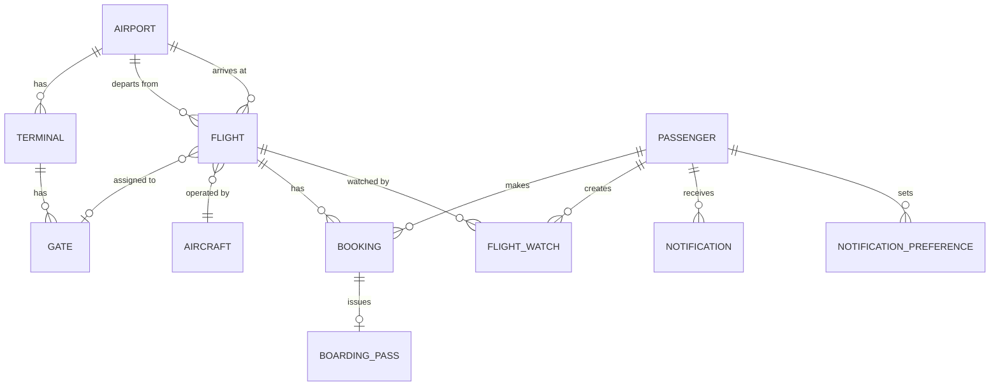
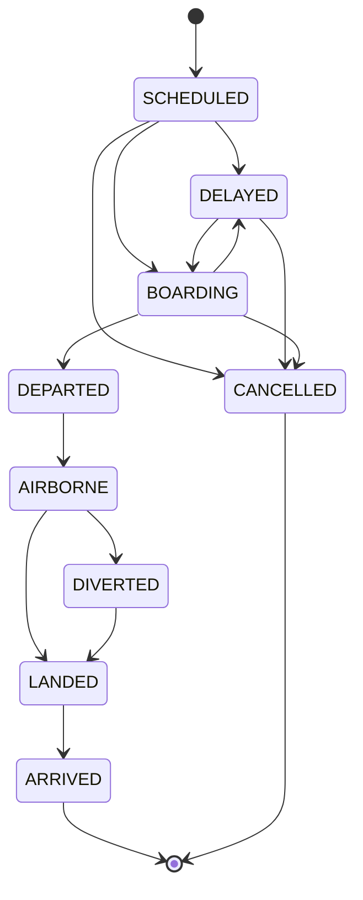

# Domain Model

The shared vocabulary of the platform. Code for the cross-cutting parts lives in [`packages/domain`](../packages/domain/src).

## Bounded contexts and ownership

| Context       | Owning service           | Entities                                          |
| ------------- | ------------------------ | ------------------------------------------------- |
| Airports      | `subgraph-airports`      | Airport, Terminal, Gate                           |
| Flights       | `subgraph-flights`       | Flight, FlightLeg, Aircraft, GateAssignment       |
| Passengers    | `subgraph-passengers`    | Passenger, Booking, BoardingPass                  |
| Notifications | `subgraph-notifications` | NotificationPreference, FlightWatch, Notification |

A service owns the only writable copy of its entities. Other services refer to them by key (`Airport.iata`, `Flight.id`, `Passenger.id`) and resolve them through federation.

## Entities



| Entity                 | Key fields                                                                                                                                             |
| ---------------------- | ------------------------------------------------------------------------------------------------------------------------------------------------------ |
| Airport                | `iata` (CAI), `icao` (HECA), name, city, country, timezone, lat/lon                                                                                    |
| Terminal               | id, airportIata, name                                                                                                                                  |
| Gate                   | id, terminalId, code (B04), isOpen                                                                                                                     |
| Flight                 | id, flightNumber (FO123), origin, destination, scheduled/estimated/actual departure and arrival, status, gateId, aircraftId, delayMinutes, delayReason |
| FlightLeg              | for multi-leg itineraries (later phase)                                                                                                                |
| Aircraft               | registration, type (A320neo), seatCount                                                                                                                |
| Passenger              | id, name, email, phone, passportNumber (**PII, ops-only, redacted from logs**)                                                                         |
| Booking                | id (PNR), passengerId, flightId, seat, cabin, status                                                                                                   |
| BoardingPass           | bookingId, boardingGroup, barcode                                                                                                                      |
| FlightWatch            | passengerId, flightId, source (`BOOKING` or `MANUAL`)                                                                                                  |
| NotificationPreference | passengerId, channel (`IN_APP`, `EMAIL`, `PUSH`), eventTypes, quietHours                                                                               |
| Notification           | id, passengerId, flightId, eventId, channel, status, sentAt, readAt                                                                                    |

All times are stored in UTC and rendered in the airport's local timezone.

## Flight status state machine

Implemented in [`packages/domain/src/flight-status.ts`](../packages/domain/src/flight-status.ts). Every status mutation must go through `transitionFlight()`.



Rules:

- A further delay on an already `DELAYED` flight updates `estimatedDeparture` and `delayMinutes`; it is **not** a transition and emits `FlightDelayed` again.
- Once `DEPARTED`, a flight cannot be cancelled and gate changes are rejected (`hasDeparted()`).
- `ARRIVED` and `CANCELLED` are terminal.
- A `DIVERTED` flight lands at a different airport; the arrival airport change is recorded on the flight.

## Domain events

Published through the transactional outbox ([ADR 0006](adr/0006-transactional-outbox.md)) to the Redis channel `flight.events` and the replay stream `flight.events.stream`. Contracts are zod schemas in [`packages/events`](../packages/events/src/index.ts). Every event shares one envelope, and every payload carries `flightNumber`, `originIata` and `destinationIata`, so consumers can route an event without looking the flight up:

```json
{
  "id": "uuid",
  "type": "FlightGateChanged",
  "version": 1,
  "flightId": "uuid",
  "occurredAt": "2026-11-06T18:30:00.000Z",
  "payload": {
    "flightNumber": "FO101",
    "originIata": "CAI",
    "destinationIata": "LHR",
    "oldGate": "A12",
    "newGate": "B04"
  }
}
```

| Event                 | Emitted when                               | Extra payload fields                                                                               |
| --------------------- | ------------------------------------------ | -------------------------------------------------------------------------------------------------- |
| `FlightStatusChanged` | any state-machine transition               | `from`, `to`                                                                                       |
| `FlightDelayed`       | new or revised delay                       | `delayMinutes` (total), `previousDelayMinutes`, `reason`, `estimatedDeparture`, `estimatedArrival` |
| `FlightGateChanged`   | gate assigned (`oldGate: null`) or changed | `oldGate`, `newGate`                                                                               |
| `FlightCancelled`     | transition to `CANCELLED`                  | `reason`                                                                                           |
| `FlightDiverted`      | transition to `DIVERTED`                   | `divertedToIata`, `reason`, `estimatedArrival`                                                     |
| `BookingCreated`      | a passenger books a flight                 | _planned for Phase 6_                                                                              |

A first delay emits `FlightStatusChanged` (to `DELAYED`) followed by `FlightDelayed`. A further delay emits only `FlightDelayed`. Delivery is at-least-once, so consumers deduplicate by `id`.

Events are versioned: additive changes keep the version, while breaking changes publish a new version alongside the old one until consumers migrate.

## Roles

| Role        | Can                                                                     |
| ----------- | ----------------------------------------------------------------------- |
| `PASSENGER` | read public flight data, own bookings and notifications, watch flights  |
| `OPS`       | everything above plus mutate flights (delay, gate, cancel) and read PII |
| `ADMIN`     | everything plus manage reference data and users                         |
